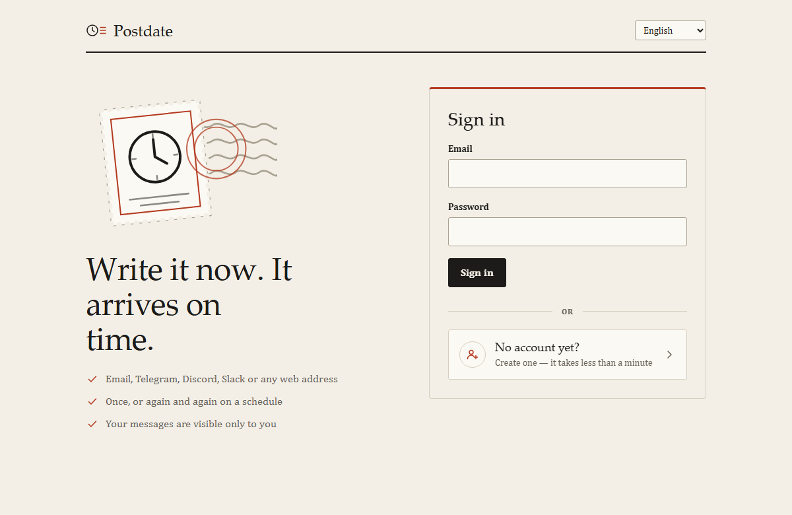
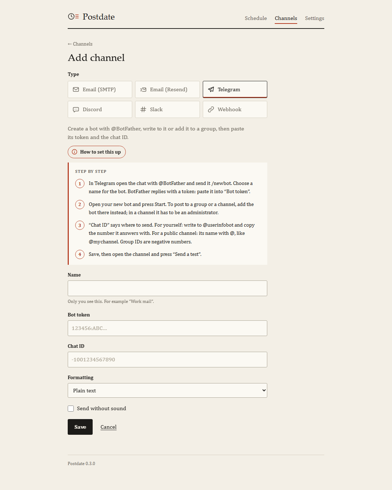
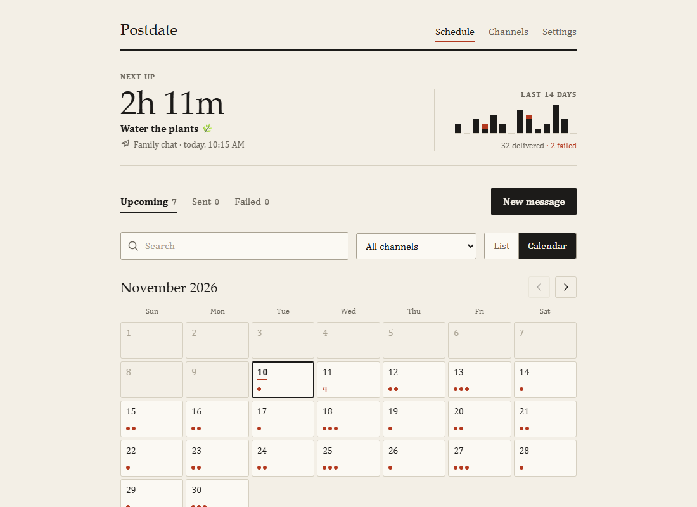

# Postdate

Write a message now, have it delivered later.

Postdate is a small self-hosted scheduler for messages. You pick where a message
goes (an email address, a Telegram chat, a Discord or Slack channel, or any URL),
write it, and choose a time. It runs on your own computer or on your own
Cloudflare account, where it fits inside the free plan and has no server for you
to look after.


## What it does

- **Six kinds of destination.** Email over SMTP (Gmail, Outlook, Fastmail, your
  own server), email through Resend, Telegram, Discord, Slack, and generic
  webhooks for everything else: ntfy, Home Assistant, your own API.
- **One-off or repeating.** Once, or every N days, weeks, months or years. A
  weekly message can run on chosen days (Monday, Wednesday and Friday, say), and
  any repeat can end on a date or after a number of sends.
- **Pause and resume.** Take a message off the schedule without deleting it.
- **Variables.** `{{date}}`, `{{time}}`, `{{count}}` and `{{days:2027-01-01}}`
  are filled in at the moment of sending, so a daily message can count down to
  something.
- **A calendar.** See the month ahead, with every repeat on the day it will run.
- **Time zones done properly.** A message set for 09:00 in Kyiv stays at 09:00
  when the clocks change.
- **Retries.** A failed delivery is tried again after one minute and after five.
  Every attempt is in the delivery log, with the error.
- **Thirteen languages.** English, Español, Português, Français, Deutsch,
  Українська, Русский, Türkçe, العربية, हिन्दी, 简体中文, 日本語, 한국어.
- **Yours to look at.** Light and dark themes, four accent colors, 12- or
  24-hour time.
- **Accounts.** Anyone you share the address with can sign up with an email
  and a password; each account sees only its own messages and channels. Set
  `SIGNUPS` to `closed` to keep an instance to the accounts it already has.
- **Private by design.** Channel credentials are encrypted at rest. No
  analytics, no third-party scripts.

Messages go out within a minute of the time you set; the dispatcher wakes once a
minute.

## Install

You need [Node.js](https://nodejs.org) 22 or newer. Download Postdate (the green
**Code** button → **Download ZIP**, or `git clone`), then:

| System | Do this |
| --- | --- |
| Windows | Double-click **`install.cmd`**. If Node.js is missing it offers to install it. |
| macOS, Linux | Run `./install.sh` in a terminal. |

The installer asks a few questions, in the language you choose from the
thirteen the app speaks, and does everything else itself:

1. **Language.** Used for the installer and as the language the app opens in.
2. **Where Postdate runs.**
   - *On this computer*: nothing to sign up for. Messages go out while the
     computer is on and Postdate is running.
   - *On Cloudflare*: needs a free [Cloudflare account](https://dash.cloudflare.com/sign-up).
     Works around the clock and from any device, inside the free plan.
3. **Folder for your data** (on this computer only): any folder on any disk.
4. **Who may create an account**: anyone who opens the address, or only the
   first account, which will be yours.

It then builds the app, creates the encryption key, and either starts Postdate
or publishes it and prints its address. Open it and press **No account yet?**
to create your account.



To start Postdate on your computer later, double-click **`Postdate.cmd`**
(Windows; the installer can put a shortcut on the desktop) or run
`./postdate.sh`. Run the installer again whenever you want to change an
answer; it starts from your previous ones and never replaces your key or data.

Every question can also be answered on the command line, for example
`install.cmd --lang=de --mode=local --data=D:\Postdate --signups=closed`.

To update later: `git pull && npm install`, then `npm run deploy` (Cloudflare)
or just start Postdate again (this computer). The database is upgraded by the
app itself the first time the new version runs.

## Setting up a channel

A channel is a place messages can be sent to. Add one under **Channels**, then
use **Send a test** to check it. The form has a **How to set this up** button
that opens step-by-step instructions for the kind of channel you picked, in the
language you use the app in.



In short:

| Channel | What you need |
| --- | --- |
| Email (SMTP) | Server, port (587 or 465), username, password. For Gmail: server `smtp.gmail.com`, port `587`, and an [app password](https://myaccount.google.com/apppasswords) rather than your normal one. A reply-to address is optional. |
| Email (Resend) | An API key and a From address on a domain you verified at [resend.com](https://resend.com). A reply-to address is optional. |
| Telegram | A bot token from [@BotFather](https://t.me/BotFather) and the chat ID. Write to the bot first (or add it to the group) so it is allowed to message you. Messages can be plain text, Markdown or HTML, and can be sent without sound. |
| Discord | A webhook URL: channel settings → Integrations → Webhooks. You can choose the name the message appears under. |
| Slack | An [incoming webhook](https://api.slack.com/messaging/webhooks) URL. |
| Webhook | Any URL. Choose the method and headers; the message text is sent as the request body. |

Port 25 is not available on Cloudflare Workers. Use 587 or 465.

## Scheduling



Pick a date, a time and a time zone. For a repeating message you can also set:

- **Interval**: every 2 weeks, every 3 months, and so on.
- **Days of the week** (weekly only): the message runs on each chosen day.
  With an interval of 2 it runs on those days every second week, counting
  weeks from the date you picked.
- **Ends**: never, on a last day, or after a number of sends.

The form shows the next few sends as you type, so you can check the schedule
before saving it.

Variables go anywhere in the subject or the body:

| Variable | Becomes |
| --- | --- |
| `{{date}}` | The date of sending, like `2027-03-09`, in the message's time zone |
| `{{time}}` | The time of sending, like `08:05` |
| `{{count}}` | `1` for the first send, `2` for the second, and so on |
| `{{days:2027-12-31}}` | Whole days left until that date |

A paused message keeps its place in the list but is not sent. When you resume a
repeating message it carries on from its next slot; sends missed during the
pause are not made up for.

**Settings → Download a backup** saves your messages and channels as a JSON
file. Passwords, tokens and webhook URLs are left out of it.

## How it works

```
browser ──▶ Worker (API + web app) ──▶ D1 database
                    ▲
   cron, every minute: pick up what is due, send it, record the result
```

- One Cloudflare Worker serves the web app and the API. On your own computer
  the same Worker runs locally, and the launcher calls the dispatcher once a
  minute in place of the cron trigger.
- Messages, channels and the delivery log live in a D1 database.
- A cron trigger runs every minute. It claims the messages that are due, sends
  them, and writes down what happened. A repeating message is then moved to its
  next slot.
- Delivery is at-least-once. In the rare case that a run dies between sending
  and recording, the message is sent again rather than lost.

The free Workers plan is plenty for personal use. Each run handles up to ten
messages, so up to ten per minute.

## Security

The short version: hashed passwords; every account limited to its own rows;
strict same-origin rules; channel credentials encrypted with a key that is kept
outside the database. Details, limits and how to recover a lost password are in
[SECURITY.md](SECURITY.md).

## Development

```sh
npm install
npm run dev        # http://localhost:5173, with a local database
npm test
npm run typecheck
```

See [CONTRIBUTING.md](CONTRIBUTING.md) for the layout of the code and for how to
add a channel type or a language.

## License

[MIT](LICENSE)
