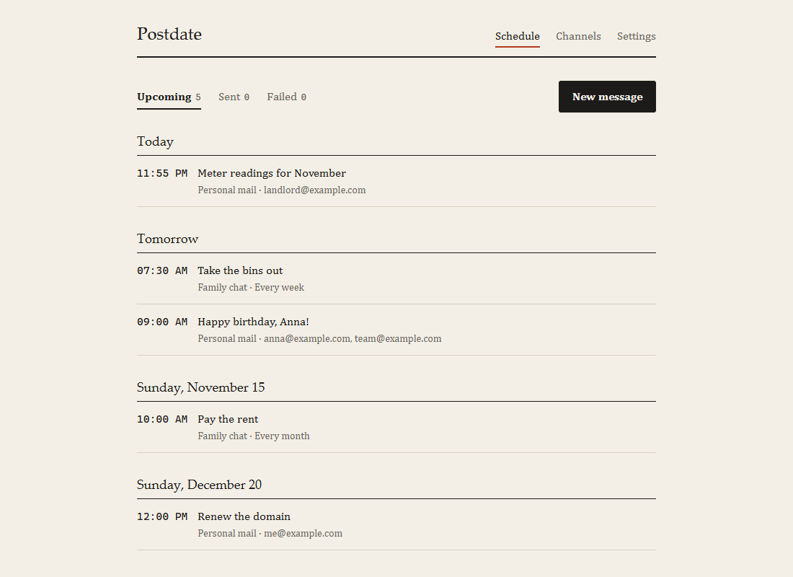

# Postdate

Write a message now, have it delivered later.

Postdate is a small self-hosted scheduler for messages. You pick where a message
goes (an email address, a Telegram chat, a Discord or Slack channel, or any URL),
write it, and choose a time. It runs on your own Cloudflare account, fits inside
the free plan, and has no server for you to look after.



## What it does

- **Six kinds of destination.** Email over SMTP (Gmail, Outlook, Fastmail, your
  own server), email through Resend, Telegram, Discord, Slack, and generic
  webhooks for everything else: ntfy, Home Assistant, your own API.
- **One-off or repeating.** Once, daily, weekly, monthly or yearly.
- **Time zones done properly.** A message set for 09:00 in Kyiv stays at 09:00
  when the clocks change.
- **Retries.** A failed delivery is tried again after one minute and after five.
  Every attempt is in the delivery log, with the error.
- **Thirteen languages.** English, Español, Português, Français, Deutsch,
  Українська, Русский, Türkçe, العربية, हिन्दी, 简体中文, 日本語, 한국어.
- **Private by design.** One owner, one password. Channel credentials are
  encrypted at rest. No analytics, no third-party scripts.

Messages go out within a minute of the time you set; the dispatcher wakes once a
minute.

## Deploy

You need a free [Cloudflare account](https://dash.cloudflare.com/sign-up) and
[Node.js](https://nodejs.org) 22 or newer.

```sh
git clone https://github.com/Vobank/postdate.git
cd postdate
npm install
npm run setup
```

`npm run setup` signs you in to Cloudflare if needed, builds and deploys the
app, creates its database, and generates the encryption key. At the end it
prints your address, something like `https://postdate.your-name.workers.dev`.

**Open that address straight away and choose a password.** Until you do, the
first visitor can claim the instance.

Prefer a button?

[](https://deploy.workers.cloudflare.com/?url=https://github.com/Vobank/postdate)

To update later: `git pull && npm install && npm run deploy`.

## Setting up a channel

A channel is a place messages can be sent to. Add one under **Channels**, then
use **Send a test** to check it.

| Channel | What you need |
| --- | --- |
| Email (SMTP) | Server, port (587 or 465), username, password. For Gmail: server `smtp.gmail.com`, port `587`, and an [app password](https://myaccount.google.com/apppasswords) rather than your normal one. |
| Email (Resend) | An API key and a From address on a domain you verified at [resend.com](https://resend.com). |
| Telegram | A bot token from [@BotFather](https://t.me/BotFather) and the chat ID. Write to the bot first (or add it to the group) so it is allowed to message you. |
| Discord | A webhook URL: channel settings → Integrations → Webhooks. |
| Slack | An [incoming webhook](https://api.slack.com/messaging/webhooks) URL. |
| Webhook | Any URL. Choose the method and headers; the message text is sent as the request body. |

Port 25 is not available on Cloudflare Workers. Use 587 or 465.

## How it works

```
browser ──▶ Worker (API + web app) ──▶ D1 database
                    ▲
   cron, every minute: pick up what is due, send it, record the result
```

- One Cloudflare Worker serves the web app and the API.
- Messages, channels and the delivery log live in a D1 database.
- A cron trigger runs every minute. It claims the messages that are due, sends
  them, and writes down what happened. A repeating message is then moved to its
  next slot.
- Delivery is at-least-once. In the rare case that a run dies between sending
  and recording, the message is sent again rather than lost.

The free Workers plan is plenty for personal use. Each run handles up to ten
messages, so up to ten per minute.

## Security

The short version: a single password, hashed; strict same-origin rules; channel
credentials encrypted with a key that is kept outside the database. Details,
limits and how to recover a lost password are in [SECURITY.md](SECURITY.md).

## Development

```sh
npm install
npm run dev        # http://localhost:5173, with a local database
npm test
npm run typecheck
```

See [CONTRIBUTING.md](CONTRIBUTING.md) for the layout of the code and for how to
add a channel type or a language.

## License

[MIT](LICENSE)
